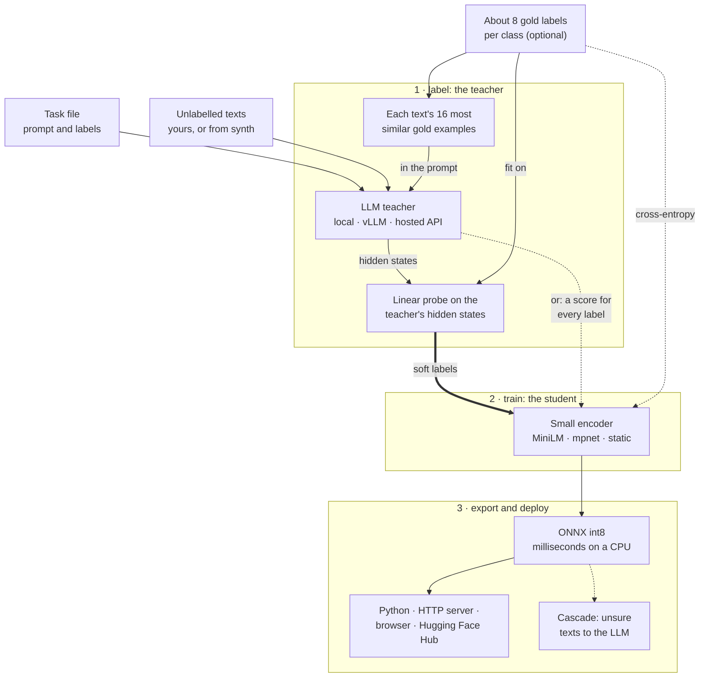

# Andreas Hummelmose

### MSc Computer Science student at Aalborg University · Machine learning research · LLMs · Recommender systems

---

## About me

I'm a master's student in computer science at Aalborg University, Denmark, working on machine learning research. I care about the gap between what machine learning methods are claimed to do and what they actually do, so I analyse methods from first principles, reproduce published results under controlled conditions, and build small, well-tested research software that makes results easy to verify.

## What I work on

- **Machine learning research**: how training choices such as loss functions, reweighting and regularisation change what a model actually learns, backed by proofs and controlled experiments.
- **LLMs and generative AI**: parameter-efficient fine-tuning with **LoRA** and **QLoRA**, 4-bit quantisation, and open models such as **Qwen**.
- **LLM inference optimisation**: distilling large language models into smaller, faster ones, the topic of my bachelor's project.
- **Recommender systems**: multimodal and cold-start recommendation, graph-based recommenders, and the reproducibility of published models.
- **Reproducible research**: controlled experiments, sound statistics, and long training runs on GPU clusters.

## Projects

### tinydistill

Distil an LLM classification prompt into a small, fast model that runs on a CPU. Describe the task in a short YAML file and give it unlabelled texts: an instruction-tuned LLM labels them with soft targets, a small encoder learns to imitate them, and the result is exported to ONNX, optionally int8. It continues my bachelor's project on inference optimisation by distilling LLMs.

**[Try the live demo](https://andreas-hum.github.io/tinydistill/demo/)** · [Documentation](https://andreas-hum.github.io/tinydistill/) · [Code](https://github.com/Andreas-Hum/tinydistill) · `pip install tinydistill`

**Results on Banking77** (77 intents, 3,080 held-out test texts; latency per text, one at a time; the teacher sees
each text's 16 most similar of 616 gold examples (8 per class) and adds a linear probe on its hidden states, and the
student learns from its soft labels plus those gold labels;
[all benchmarks](https://github.com/Andreas-Hum/tinydistill/blob/main/RESULTS.md)):

| Model | Runs on | Accuracy | Latency | Size | Speed-up |
|---|---|---|---|---|---|
| Teacher: Qwen2.5-7B, 4-bit, 16 similar examples + probe | RTX 4090 | 0.859 | 155 ms | 5.4&nbsp;GB | 1x |
| Student: MiniLM-L6, int8 | CPU, 2 threads | **0.872** | 1.0 ms | 23&nbsp;MB | **153x** |

The student is more accurate than its teacher and over 150 times faster on a CPU than the teacher on a GPU. With the
probe alone as the teacher (the default from 0.7.0), labelling takes minutes instead of hours: on CLINC150 (151 intents) the
deployed student reaches 0.851 after 37 minutes of labelling, against 0.859 after 7.2 hours.

### Distillation Playground

<table>
<tr>
<td>
An interactive, in-browser demo of knowledge distillation. A teacher network and three small students train side by side on 2D data: one from the labels alone, one from the teacher's hard answers and one from its soft targets. A live view of each neuron, the probabilities of every model at any point, and sliders for the temperature, the mixing weight, the student size and the teacher's quality show when distillation helps. Written from scratch in TypeScript, with no ML library and gradient-checked backpropagation.
  
<b><a href="https://andreas-hum.github.io/distillation-playground/">Try the live demo</a></b> · <a href="https://github.com/Andreas-Hum/distillation-playground">Code</a>
</td>
<td width="340">

</td>
</tr>
</table>

## Tech stack

**Languages**

**Machine learning**

**Methods and models**

`LoRA` `QLoRA` `PEFT` `Quantisation` `Knowledge distillation` `Inference optimisation` `Hashing` `Qwen` `Transformers`
`Recommender systems` `Graph neural networks` `Multimodal learning` `Class imbalance` `Statistical testing`
`Closed-form recommenders` `Cold-start recommendation` `Pre-registered evaluation`

**Research and infrastructure**

**Web (earlier projects)**

## Education

- **MSc in Computer Science**, Aalborg University (ongoing)
- **BSc in Computer Science**, Aalborg University, with a bachelor's project on inference optimisation by distilling LLMs

## Currently

- Writing up research on machine learning training objectives
- Pre-thesis project on reproducibility and cold-start ranking in multimodal recommender systems
- Contributor to Hugging Face transformers ([fix for Doge's MoE load-balancing loss](https://github.com/huggingface/transformers/pull/50266))
- Open to collaborations on machine learning research and tooling

## Contributions

<picture>
  <source media="(prefers-color-scheme: dark)" srcset="https://raw.githubusercontent.com/Andreas-Hum/Andreas-Hum/output/github-snake-dark.svg">
  
</picture>
