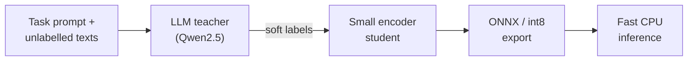

# Hi, I'm Andreas

### MSc Computer Science student at Aalborg University · Machine learning research · LLMs · Recommender systems

---

## About me

I'm a master's student in computer science at Aalborg University, Denmark, working on machine learning research. I care about the gap between what machine learning methods are claimed to do and what they actually do, so I analyse methods from first principles, reproduce published results under controlled conditions, and build small, well-tested research software that makes results easy to verify.

## What I work on

- **Machine learning research**: how training choices such as loss functions, reweighting and regularisation change what a model actually learns, backed by proofs and controlled experiments.
- **LLMs and generative AI**: parameter-efficient fine-tuning with **LoRA** and **QLoRA**, 4-bit quantisation, and open models such as **Qwen**.
- **LLM inference optimisation**: distilling large language models into smaller, faster ones, the topic of my bachelor's project.
- **Recommender systems**: multimodal and cold-start recommendation, graph-based recommenders, and the reproducibility of published models.
- **Reproducible research**: controlled experiments, sound statistics, and long training runs on GPU clusters.

## Projects

### tinydistill 

Distil an LLM classification prompt into a small, fast model that runs on a CPU. Describe the task in a short YAML file and give it unlabelled texts: an instruction-tuned LLM labels them with soft targets, a small encoder learns to imitate them, and the result is exported to ONNX, optionally int8. It continues my bachelor's project on inference optimisation by distilling LLMs. [Code](https://github.com/Andreas-Hum/tinydistill)

### Distillation Playground

<table>
<tr>
<td>
An interactive, in-browser demo of knowledge distillation. A teacher network and two small students train side by side on 2D data, one from the labels alone and one from the teacher's soft targets; sliders for the temperature, the mixing weight and the student size show when distillation helps. Written from scratch in TypeScript, with no ML library and gradient-checked backpropagation.
  
<b><a href="https://andreas-hum.github.io/distillation-playground/">Try the live demo</a></b> · <a href="https://github.com/Andreas-Hum/distillation-playground">Code</a>
</td>
<td width="340">

</td>
</tr>
</table>

## Tech stack

**Languages**

**Machine learning**

**Methods and models**

`LoRA` `QLoRA` `PEFT` `Quantisation` `Knowledge distillation` `Inference optimisation` `Hashing` `Qwen` `Transformers`
`Recommender systems` `Graph neural networks` `Multimodal learning` `Class imbalance` `Statistical testing`

**Research and infrastructure**

**Web (earlier projects)**

## Education

- **MSc in Computer Science**, Aalborg University (ongoing)
- **BSc in Computer Science**, Aalborg University, with a bachelor's project on inference optimisation by distilling LLMs

## Currently

- Writing up research on machine learning training objectives
- Pre-thesis project on multimodal recommender systems
- Open to collaborations on machine learning research and tooling

---

*"Measure what models actually learn, not what they are claimed to learn."*

