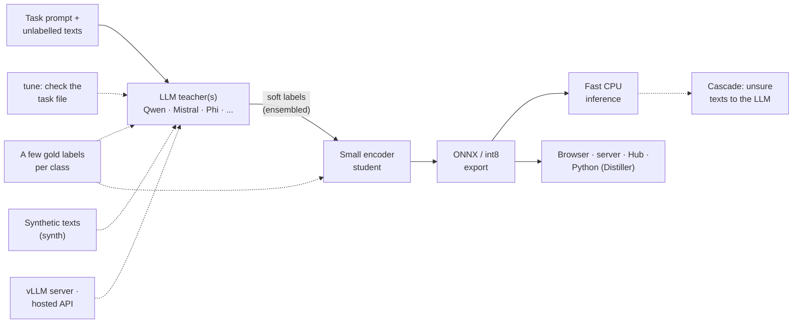

# Hi, I'm Andreas

### MSc Computer Science student at Aalborg University · Machine learning research · LLMs · Recommender systems

---

## About me

I'm a master's student in computer science at Aalborg University, Denmark, working on machine learning research. I care about the gap between what machine learning methods are claimed to do and what they actually do, so I analyse methods from first principles, reproduce published results under controlled conditions, and build small, well-tested research software that makes results easy to verify.

## What I work on

- **Machine learning research**: how training choices such as loss functions, reweighting and regularisation change what a model actually learns, backed by proofs and controlled experiments.
- **LLMs and generative AI**: parameter-efficient fine-tuning with **LoRA** and **QLoRA**, 4-bit quantisation, and open models such as **Qwen**.
- **LLM inference optimisation**: distilling large language models into smaller, faster ones, the topic of my bachelor's project.
- **Recommender systems**: multimodal and cold-start recommendation, graph-based recommenders, and the reproducibility of published models.
- **Reproducible research**: controlled experiments, sound statistics, and long training runs on GPU clusters.

## Projects

### tinydistill

Distil an LLM classification prompt into a small, fast model that runs on a CPU. Describe the task in a short YAML file and give it unlabelled texts: an instruction-tuned LLM labels them with soft targets, a small encoder learns to imitate them, and the result is exported to ONNX, optionally int8. It continues my bachelor's project on inference optimisation by distilling LLMs.

**[Try the live demo](https://andreas-hum.github.io/tinydistill/demo/)** · [Documentation](https://andreas-hum.github.io/tinydistill/) · [Code](https://github.com/Andreas-Hum/tinydistill) · `pip install tinydistill`

**Results on Banking77** (77 intents, 3,080 held-out test texts; latency per text on an RTX 4090 for the teacher and 2
CPU threads for the students; the students learn from the teacher's soft labels plus 8 gold labels per class;
[all benchmarks](https://github.com/Andreas-Hum/tinydistill/blob/main/RESULTS.md)):

| Model | Runs on | Accuracy | Latency | Size | Speed-up |
|---|---|---|---|---|---|
| Teacher: Qwen2.5-7B, 4-bit, 8-shot | GPU | 0.783 | 264 ms | 5.4&nbsp;GB | 1x |
| Student: MiniLM-L6, int8 | CPU | **0.814** | 1.2 ms | 23&nbsp;MB | **214x** |
| Student: static embeddings, int8 | CPU | 0.802 | 0.1 ms | 8&nbsp;MB | **3244x** |

The students are more accurate than their teacher and hundreds of times faster on a CPU than the teacher on a GPU.

### Distillation Playground

<table>
<tr>
<td>
An interactive, in-browser demo of knowledge distillation. A teacher network and two small students train side by side on 2D data, one from the labels alone and one from the teacher's soft targets; sliders for the temperature, the mixing weight and the student size show when distillation helps. Written from scratch in TypeScript, with no ML library and gradient-checked backpropagation.
  
<b><a href="https://andreas-hum.github.io/distillation-playground/">Try the live demo</a></b> · <a href="https://github.com/Andreas-Hum/distillation-playground">Code</a>
</td>
<td width="340">

</td>
</tr>
</table>

## Open-source contributions

Mathematical bugs I found and reported in widely used ML libraries, each with a minimal reproduction, and fixed in a
pull request where I could.

| Library | Finding | Status |
|---|---|---|
| [transformers](https://github.com/huggingface/transformers) | Doge's load-balancing loss paired expert loads (by expert id) with router probabilities in sorted rank order | **[Fix merged](https://github.com/huggingface/transformers/pull/50266)** |
| transformers | Doge's MoE router reshape mixes tokens, so its logits depend on future tokens and other sequences in the batch | [Issue](https://github.com/huggingface/transformers/issues/50230) |
| transformers | `TopHLogitsWarper` does not implement the documented Top-H rule | [Issue](https://github.com/huggingface/transformers/issues/50228) |
| transformers | `ClapModel(return_loss=True)` computes the text-to-audio loss twice and never the audio-to-text loss | [Issue](https://github.com/huggingface/transformers/issues/50227) |
| [PyTorch](https://github.com/pytorch/pytorch) | `kl_divergence` of transformed distributions returns the base KL for non-injective transforms | [Issue](https://github.com/pytorch/pytorch/issues/202967) |
| PyTorch | `kl_divergence(Wishart, Wishart)` is wrong for batched distributions and has no gradient with respect to `p` | [Issue](https://github.com/pytorch/pytorch/issues/202966) |
| PyTorch | `kl_divergence(Categorical, Categorical)` gives a NaN gradient when `p` has `-inf` logits | [Issue](https://github.com/pytorch/pytorch/issues/202965) |
| PyTorch | `torch.sparse.mm` on CUDA is nondeterministic, and deterministic mode neither fixes nor flags it | [Issue](https://github.com/pytorch/pytorch/issues/202030) |
| [Keras](https://github.com/keras-team/keras) | `sparse_categorical_crossentropy(from_logits=True)` returns NaN on JAX and NumPy for `-inf` non-target logits | [PR](https://github.com/keras-team/keras/pull/24127) |
| Keras | Focal cross-entropy with `from_logits=True` saturates, so confidently wrong logits get zero gradient | [PR](https://github.com/keras-team/keras/pull/24126) |
| Keras | `CutMix`'s `factor` is the range of the Beta concentration, not of the mixing weight | [PR](https://github.com/keras-team/keras/pull/24128) |
| [bitsandbytes](https://github.com/bitsandbytes-foundation/bitsandbytes) | LAMB and LARS never update a zero-norm parameter (zero-initialised biases, LoRA B matrices) | [PR](https://github.com/bitsandbytes-foundation/bitsandbytes/pull/2117) |
| [lighteval](https://github.com/huggingface/lighteval) | The standard error of averaged rows is the mean of the subtask errors, about 7x too large on MMLU | [PR](https://github.com/huggingface/lighteval/pull/1468) |
| [TensorFlow Probability](https://github.com/tensorflow/probability) | KL divergence of transformed distributions with a non-injective bijector returns the base KL | [PR](https://github.com/tensorflow/probability/pull/2037) |
| [solo-learn](https://github.com/vturrisi/solo-learn) | The SupCon loss is the paper's L_in, not the L_out it specifies (Khosla et al. 2020, Eq. 2) | [PR](https://github.com/vturrisi/solo-learn/pull/402) |
| [diffusers](https://github.com/huggingface/diffusers) | `--logit_mean` shifts SD3 training timesteps in the opposite direction to the paper | [Issue](https://github.com/huggingface/diffusers/issues/15166) |
| [NVIDIA Merlin](https://github.com/NVIDIA-Merlin) | The logQ correction is applied before the temperature, which biases sampled-softmax training towards popular items ([models](https://github.com/NVIDIA-Merlin/models/issues/1249), [Transformers4Rec](https://github.com/NVIDIA-Merlin/Transformers4Rec/issues/826)); unique log-uniform sampling keeps the smallest ids | [Issue](https://github.com/NVIDIA-Merlin/Transformers4Rec/issues/825) |

## Tech stack

**Languages**

**Machine learning**

**Methods and models**

`LoRA` `QLoRA` `PEFT` `Quantisation` `Knowledge distillation` `Inference optimisation` `Hashing` `Qwen` `Transformers`
`Recommender systems` `Graph neural networks` `Multimodal learning` `Class imbalance` `Statistical testing`
`Closed-form recommenders` `Cold-start recommendation` `Pre-registered evaluation`

**Research and infrastructure**

**Web (earlier projects)**

## Education

- **MSc in Computer Science**, Aalborg University (ongoing)
- **BSc in Computer Science**, Aalborg University, with a bachelor's project on inference optimisation by distilling LLMs

## Currently

- Writing up research on machine learning training objectives
- Pre-thesis project on reproducibility and cold-start ranking in multimodal recommender systems
- Auditing ML libraries for mathematical bugs ([contributions](#open-source-contributions))
- Open to collaborations on machine learning research and tooling

## Contributions

<picture>
  <source media="(prefers-color-scheme: dark)" srcset="https://raw.githubusercontent.com/Andreas-Hum/Andreas-Hum/output/github-snake-dark.svg">
  
</picture>

---

*"Measure what models actually learn, not what they are claimed to learn."*

